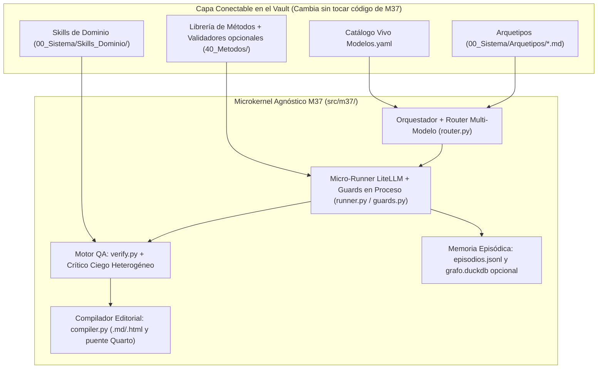

# M37 (Move 37) — Arquitectura Maestra v2.0

> **Proyecto:** **M37** (*Move 37*)
> **Qué es esto.** Documento maestro de arquitectura v2.0 de **M37**, sincronizado con las cinco especificaciones de ingeniería (`SPEC-01` a `SPEC-05`). Evoluciona el diseño conceptual v1.0 hacia un **Microkernel Agnóstico + Enrutamiento Dinámico Multi-Modelo + Modo Bare Bones Compartible**: el núcleo del sistema desconoce disciplinas específicas (no asume estadística, derecho, finanzas ni estrategia) y ejecuta cualquier tipo de encargo con garantías deterministas de aislamiento, trazabilidad y aseguramiento de calidad.
>
> **Fecha:** 27 de octubre de 2026
> **Mapa documental del proyecto:**
> * `00_M37_Arquitectura_v2.md` — Visión integral, principios no negociables y decisiones arquitectónicas (este documento).
> * `SPEC-01_Empaquetado_y_BareBones.md` — Separación repo público (`m37-core`) vs. workspace privado, dependencias mínimas y CLI `m37`.
> * `SPEC-02_Enrutamiento_Modelos_y_Runtime.md` — Catálogo vivo `Modelos.yaml`, criterio del Orquestador, QA heterogéneo y runner `LiteLLM`.
> * `SPEC-03_Contratos_Permisos_y_Estados.md` — Esquemas Pydantic v2, máquina de estados, invalidación por hashes y guardias de seguridad.
> * `SPEC-04_Agentes_Plugins_y_Compilador.md` — Los 6 agentes nucleares, API de plugins (Dominios, Métodos, Arquetipos) y compilador editorial.
> * `SPEC-05_Memoria_Full_y_Build_Blueprint.md` — Memoria episódica, grafo bitemporal DuckDB + MCP, gobierno `L4` y plan ejecutable de construcción.

---

## 1. Resumen de evolución (Delta v1.0 → M37 v2.0)

| Dimensión | Diseño v1.0 | M37 v2.0 (Microkernel Agnóstico) | Riesgo o costo resuelto |
|---|---|---|---|
| **Agnosticismo de tarea** | `Hallazgo` exigía `magnitud`, `unidad`, `periodo` (sesgo cuantitativo); `legal` tenía reglas ad-hoc | **Kernel 100% agnóstico (`SPEC-03`):** contratos base sirven igual para estrategia cualitativa, revisión normativa, síntesis documental, modelado numérico o desarrollo de software. La semántica específica vive en *Plugins* | **Bloqueante:** impide que el sistema fuerce estructuras numéricas en tareas cualitativas o acople el motor a una sola práctica |
| **Runtime y Modelos** | Acoplado a Claude Code (`.claude/agents/`) | **Multi-proveedor sobre `LiteLLM` (`SPEC-02`):** usuario elige solo al Orquestador (`--orchestrator`); el Orquestador asigna modelos por nodo desde `Modelos.yaml` y fuerza **QA heterogéneo entre familias** | **Bloqueante:** elimina *vendor lock-in*, sobrevive al recambio trimestral de modelos y evita puntos ciegos correlacionados en QA |
| **Empaquetado e IP** | Motor y datos de clientes en el mismo repo Git | **Dos anillos (`SPEC-01`):** repo compartible `m37-core` (`Bare Bones` sin binarios pesados, arranque en <5 min) separado físicamente de `~/m37_workspace/` + modo `Full` opcional | **Bloqueante:** riesgo cero de filtrar clientes en `git push` y adopción inmediata al compartir el repositorio |
| **Confidencialidad vs. Capital** | `30_Evidencia/` y `50_Hallazgos/` globales para todos los clientes | Lo específico o privado vive dentro de `20_Encargos/<id>/` (y `codigo/<id>/` o `analisis/<id>/`); solo evidencia pública (`30_`) y capital anonimizado (`50_`) son transversales | **Bloqueante:** elimina fuga de información del Cliente A al contexto del Cliente B |
| **Trazabilidad de cálculos y matrices** | Salto sin contrato entre `analisis/` y la prosa del `Hallazgo` | Contrato opcional de **Derivación (`D-XX.json`/`.md`)**: registra insumos (hashes) y salidas clave-valor de *cualquier* transformación (financiera, lógica, regulatoria, estadística o de verificación de tests) | **Bloqueante:** evita errores de transcripción manual cuando hay cálculos o métricas técnicas, sin estorbar en encargos 100% cualitativos |
| **Aislamiento de QA y consola** | `PreToolUse` solo en escritura y `claude -p` simple en raíz | Perfiles de herramientas (`documental`, `analítico`, `construcción`, `editorial`) envueltos en proceso Python (`guards.py`), auditoría post-script y QA ciego con *allowlist* estricta | **Bloqueante:** impide saltarse permisos vía consola o que el QA lea `Nodos/` y `90_Bitacora/` |
| **Capa de control** | Supervisor LLM tras cada nodo + Dominio LLM pre/post cada nodo | **Control híbrido:** Supervisor 100% en Python; Dominio como *Skill* residente en nodos estándar y validador activo en Puertas 2/3 o dominios bloqueantes | **Mayor:** recorta ~55% de llamadas LLM y latencia; cumple la regla de no verificar esquemas formales con modelos |
| **Grafo episódico/semántico** | Neo4j o Graphiti vía MCP | `episodios.jsonl` en Bare Bones → proyectado a **grafo bitemporal en DuckDB** + MCP local `readonly` en modo Full (`SPEC-05`) | **Mayor:** elimina Docker, ~2 GB RAM y las llamadas LLM no deterministas internas de Graphiti |
| **Compilación editorial** | Transclusiones crudas `![[H-0012#Afirmación]]` hacia Quarto | `m37 compile` (`SPEC-04`): genera `.md`/`.html` nativo en Bare Bones y conecta con Quarto (`.docx`/`.pptx`/`.pdf`) en Full, auditando `<!-- sustento: H-XX -->` | **Mayor:** resuelve incompatibilidad Obsidian→Pandoc y permite prosa ejecutiva fluida con respaldo auditado |
| **Endurecimiento epistémico y anti-inyección** | Sin defensa ante *prompt injection* indirecto, inflación de certeza al redactar o concesión cosmética en Ronda 2 de QA | Cercas `<datos_fuente_no_ejecutables>`, cuarentena física de fuentes invalidadas, escalera agnóstica `fuerza_afirmacion` y bloqueo determinista de remediaciones cosméticas en Ronda 2 (`SPEC-03`/`04`) | **Mayor:** impide secuestro por documentos externos, exageración editorial y falsos positivos de QA tras simples paráfrasis |
| **Construcción genérica de software (SDD + TDD + AppSec)** | Solo scripts analíticos sueltos; sin disciplina formal para entregar herramientas o código de producción a clientes | Perfil `construccion` aislado en `codigo/<encargo>/`, Arquetipo **SDD + EARS + TDD**, recibo criptográfico `.m37_verify_receipt.json` (`tree_sha256` + `exit_code == 0`), bloqueo anti-secretos y revisión dual ciega (Spec + AppSec) | **Mayor:** elimina el *vibe-coding* frágil; impide declarar código "terminado" sin tests reales sobre el árbol exacto o con credenciales expuestas |

---

## 2. Principios de diseño — los cinco no negociables + regla del microkernel

Todo **M37** se deriva de estos cinco axiomas y su corolario de desacoplamiento:

1. **El vault (y sus artefactos en disco) es el único estado del sistema.** Los agentes no recuerdan nada entre ejecuciones. Todo insumo entra por archivo y todo producto sale por archivo. La coordinación ocurre en disco, nunca por conversación directa entre agentes.
2. **Dominio y tarea forman una matriz, no dos listas.** El agente de **tarea** sabe *cómo ejecutar un procedimiento* (investigar documentos, sintetizar entrevistas, construir un modelo, redactar un memorando). El **dominio** define *qué es válido, plausible y riesgoso en ese campo*.
3. **Los artefactos circulan con contrato verificable.** Cada nota declara su forma y condiciones de aceptación. Lo formal se verifica con código determinista; el juicio sustantivo se reserva a crítica ciega.
4. **Los enlaces son la trazabilidad de punta a punta.** La cadena `insumo (evidencia E o derivación D) → hallazgo (H) → sección de entregable` es explícita. Afirmación sin enlace saliente válido no compila; insumo sin enlaces entrantes es trabajo huérfano.
5. **Separación estructural de poderes.** Quien planea no juzga. Quien supervisa no edita. Quien audita en QA no puede leer el razonamiento intermedio ni la memoria episódica.

> [!IMPORTANT]
> **Corolario de Agnosticismo del Microkernel:** Ningún componente del código nuclear de **M37** (`src/m37/`) puede contener reglas propias de una disciplina (ni estadística, ni derecho, ni finanzas, ni estrategia) ni nombres fijos de modelos LLM. Toda semántica especializada entra como Plugin declarativo (`Arquetipo`, `Skill de Dominio`, `Validador de Método` o catálogo `Modelos.yaml`).

---

## 3. Arquitectura Microkernel + Plugins

### 3.1 Separación entre lo invariante y lo conectable



### 3.2 Roles de Dominio y `dominios_bloqueantes`

Nuevos dominios (`economia`, `datos`, `estrategia`, `mercado`, `laboral`, `legal`, etc.) se agregan creando un archivo Markdown en `00_Sistema/Skills_Dominio/`:
* **Modo residente (*Domain Skill*):** Criterios epistemológicos, fuentes admisibles, errores típicos y rúbrica de QA inyectados automáticamente según el nodo.
* **Modo activo (Validador de Dominio):** Invocado en **Puerta 2** y en nodos de riesgo alto (`L3`/`L4`).
* **Veto declarativo (`dominios_bloqueantes`):** El `00_Brief.md` o el Arquetipo declara qué dominios tienen derecho de veto obligatorio antes de Puerta 4 (p. ej. `["legal"]` en materia regulatoria o `["datos"]` en auditoría cuantitativa), sin cablear privilegios ad-hoc en el motor.

### 3.3 Perfiles Agnósticos de Herramientas

Todo agente de tarea opera bajo uno de cuatro perfiles impuestos en Python por `src/m37/guards.py`:

| Perfil | Roles típicos | Herramientas habilitadas | Herramientas prohibidas | Garantía estructural |
|---|---|---|---|---|
| **1. Documental** | `evidencia`, `investigacion-normativa` | `read_file`, `grep_vault`, `list_files`, `write_note`, `web_fetch_clean` | `run_sandbox_script`, `write_code_file`, `edit_note` (en evidencia previa) | Evidencia *append-only*; imposible ejecutar o generar código |
| **2. Analítico** | `analisis-sintesis`, `modelado`, `estadistica` | `read_file`, `grep_vault`, `list_files`, `write_note`, `edit_note`, `run_sandbox_script` (solo si `requiere_computo: true`) | `web_fetch_clean`, `write_code_file` | Trabaja solo con insumos ya registrados; no mete fuentes clandestinas |
| **3. Construcción** | `desarrollo-codigo`, `prototipado` | `read_file`, `grep_vault`, `list_files`, `write_note`, `write_code_file`, `edit_code_file`, `run_verification_cmd` | `web_fetch_clean`, `edit_note` (fuera de sus artefactos) | Código confinado a `codigo/<encargo>/`, escaneado contra secretos y sellado con recibo `.m37_verify_receipt.json` (`tree_sha256`) |
| **4. Editorial** | `redaccion`, `presentacion`, `integrador` | `read_file`, `grep_vault`, `list_files`, `write_note`, `edit_note` | `run_sandbox_script`, `run_verification_cmd`, `write_code_file`, `web_fetch_clean` | **No puede inventar fuentes, mutar código ni recalcular cifras**; solo ensambla hallazgos aprobados |

*(El rol `qa-critico` opera bajo un quinto perfil especial `qa_ciego`: solo `read_file` restringido por *allowlist* —incluyendo código/diff y recibo de verificación en solo-lectura cuando audita software— + `write_note` en `QA/`).*

---

## 4. Topología Física y Separación Público / Privado

1. **`m37-core/` (Repositorio compartible):** Código del microkernel (`src/m37/`), `docs/` (`DATA_FLOWS.md`, `RISK_REGISTER.md`), `starter_vault/` de demostración y extensiones opcionales (`extensions/`). Cero datos de clientes.
2. **`~/m37_workspace/` (Workspace privado del consultor):** Ubicado fuera de `m37-core/`, conectado vía `M37_VAULT` en `.env`:

```text
~/m37_workspace/
├── vault/                              # Carpeta que abre Obsidian
│   ├── 00_Sistema/                     # Modelos.yaml, Agentes/, Skills_Dominio/, Arquetipos/, Contratos/, Paneles/
│   ├── 10_Clientes/<Cliente>/          # Contexto, restricciones, historial comercial
│   ├── 20_Encargos/<ID-Encargo>/       # FRONTERA DE CONFIDENCIALIDAD (00_Brief, 01_Plan, Nodos, Evidencia_Interna, Derivaciones, Hallazgos, QA, Entregables)
│   ├── 30_Evidencia_Publica/           # E-YYYYMM-NNN.md (fuentes abiertas reutilizables; append-only)
│   ├── 40_Metodos/                     # Procedimientos, marcos analíticos y validadores opcionales
│   ├── 50_Capital/                     # Aprendizajes, marcos y benchmarks ANONIMIZADOS post-mortem
│   ├── 90_Bitacora/                    # Decisiones, post-mortems, episodios.jsonl
│   └── .indice/                        # grafo.duckdb (solo en modo Full, fuera de Git)
├── analisis/                           # OPCIONAL: scripts/modelos analíticos por encargo cuando requiere_computo=true
├── codigo/                             # OPCIONAL: repositorios/worktrees aislados por encargo (codigo/<ID-Encargo>/) para software entregable
├── datos/                              # OPCIONAL: archivos crudos/procesados — FUERA DE GIT
├── render/                             # Salidas compiladas (.html/.md en Bare Bones; .docx/.pptx/.pdf con Quarto en Full)
└── referencias/                        # biblioteca.bib (Zotero opcional) y snapshots documentales
```

---

## 5. Arquitectura de Memoria (Los 4 Tipos y su Matriz de Acceso)

| Memoria | Orquestador | Dominio y Tarea | Verificador Python | QA Crítico (Sesión Ciega) | Integrador |
|---|---|---|---|---|---|
| **De trabajo** | Propia | Propia | Sin estado | Propia y aislada | Propia |
| **Semántica** | Solo índices / MOCs | Encargo activo + transversales | Por ruta exacta | **Solo IDs citados (*allowlist*)** | Encargo activo completo |
| **Procedimental** | Solo catálogo | Skills del nodo | Esquemas base + plugin del método | Solo rúbrica del dominio | Completa |
| **Episódica** | Completa (`episodios.jsonl` / MCP `grafo.duckdb`) | **Sin acceso** | **Sin acceso** | **Sin acceso** | **Sin acceso** |

---

## 6. Prueba de Agnosticismo sobre 5 Encargos Contrastantes

Ninguno de estos casos modifica una sola línea de `src/m37/`:

| Tipo de encargo | Arquetipo | Perfiles activos | ¿Usa `analisis/`, `codigo/` o `D-XX`? | Dominio bloqueante |
|---|---|---|---|---|
| **1. Estrategia competitiva / mercado** | `ARQ_Diagnostico-Cualitativo` | Documental → Analítico (sin scripts) → Editorial | Opcional (`D-XX` solo si hay matriz comparativa) | `estrategia` |
| **2. Due diligence / cumplimiento** | `ARQ_Revision-Normativa` | Documental → Analítico (matriz de brechas) → Editorial | Sin código; `D-XX.md` es tabla norma × obligación | `legal` |
| **3. Revisión de literatura / policy brief** | `ARQ_Estado-del-Arte` | Documental → Analítico → Editorial | No | Dominio temático del brief |
| **4. Modelado cuantitativo / finanzas / datos** | `ARQ_Analisis-Cuantitativo` | Documental → Analítico (con sandbox Python) → Editorial | Sí (`analisis/` + `D-XX.json` + plugin opcional del método) | `datos` |
| **5. Desarrollo de software / herramienta / pipeline** | `ARQ_Construccion-Software-SDD` | Documental → Analítico (Constitución + Spec EARS) → Construcción (TDD) → Editorial | Sí (`codigo/<encargo>/` + `.m37_verify_receipt.json` + `D-XX.json`) | `ingenieria-software` |

---

## 7. Gobierno y Hoja de Ruta de Construcción

* **Niveles de rigor:** `L1` (exploratorio, sin QA externo), `L2` (interno, QA Fase A mecánica), `L3` (cliente estándar, QA Fase A + Fase B ciega heterogénea + Integrador), `L4` (litigio/peritaje, workspace efímero aislado `m37 init --clean-l4` + veto bloqueante + revisión humana línea por línea).
* **Las 4 Puertas Humanas (30–60 min c/u):** (1) Encuadre en `00_Brief.md`, (2) Método, Modelos y Presupuesto en `01_Plan.md`, (3) Hallazgos y Veredictos QA, (4) Entrega compilada.
* **Secuencia de implementación (detallada en `SPEC-05`):**
  1. **Etapa A (`v0.1.0-barebones` → `v0.2.0`):** `m37-core` (~5,000 líneas Python incluyendo guardias exhaustivas y SDD/TDD), `docs/` de transparencia (`DATA_FLOWS.md`, `RISK_REGISTER.md` `R1`–`R8`), `starter_vault/` con Arquetipos declarativos y suite `pytest` de 21 pruebas automatizadas.
  2. **Etapa B (Operación real):** Inicializar `~/m37_workspace`, cargar tus propios *Domain Skills* privados y correr encargos reales de punta a punta.
  3. **Etapa C (`v0.2.0-full`):** Puente Quarto/Zotero, `grafo.duckdb` bitemporal + servidor MCP `readonly` y paneles `.base` en Obsidian.

---

## 8. Referencias, Inspiración Conceptual y Blindaje de Licencia (*Clean-Room*)

**M37** es una arquitectura e implementación original desde cero, diseñada para licenciarse bajo términos open-source permisivos (`MIT` o `Apache-2.0`) compatibles con operación comercial en consultoría. En cumplimiento de buenas prácticas de atribución científica e ingenieril, se reconocen las siguientes referencias conceptuales:

1. **Literatura empírica sobre fallos de agentes y revisión asistida por IA:**
   * *Concesión ante reescrituras cosméticas en rondas de revisión:* Dycke, N., & Gurevych, I. (hallazgo empírico de que revisores basados en LLM tienden a aprobar segundas rondas tras paráfrasis superficiales aunque la relación de soporte subyacente siga rota; mitigado en **M37** mediante validación determinista de cambio material en `verify.py`, `SPEC-03`).
   * *Taxonomía de fallos de investigación autónoma y brecha de soporte cita-afirmación:* Lu et al. (*AI Scientist failure modes*) y literatura sobre fidelidad de atribuciones documentales (mitigado en **M37** mediante `DerivationContract`, cuarentena de insumos invalidados y `fuerza_afirmacion`).
2. **Inspiración en gobernanza epistemológica y transparencia operativa:**
   * Wu, Cheng-I (`Imbad0202/academic-research-skills`, ARS). Aunque **M37** diverge radicalmente en arquitectura técnica (microkernel agnóstico de tarea en Python *fail-closed* con enrutamiento multi-modelo vs. suite de prompts especializada en *papers* académicos sobre Claude Code), cinco principios de gobernanza observados en ARS inspiraron mejoras conceptuales en `SPEC-01`, `SPEC-03` y `SPEC-04`: (a) separación explícita instrucción/datos frente a *prompt injection* indirecto, (b) cuarentena persistente de fuentes descartadas, (c) control explícito de deriva en la fuerza de las afirmaciones, (d) exigencia de remediación material entre rondas de crítica y (e) transparencia ligera estilo ISO/IEC 42001 mediante `DATA_FLOWS.md` y `RISK_REGISTER.md`.
3. **Ingeniería de Software Dirigida por Especificaciones (SDD), Verificación Determinista y Seguridad Aplicativa:**
   * *Notación formal de requisitos verificables (EARS):* Mavin, A., Wilkinson, P., Harwood, A., & Novak, M. (2009), *"Easy Approach to Requirements Syntax (EARS)"*, *17th IEEE International Requirements Engineering Conference* (`CUANDO / SI..ENTONCES / MIENTRAS`).
   * *Flujo SDD ligero (Constitución → Especificación EARS → Plan → Verificación):* Moure, Brais (`mouredev/hello-sdd`, distribuido bajo licencia permisiva **`Apache-2.0`**). Inspiró la separación estricta entre *Constitución* + *QUÉ/POR QUÉ* (requisitos numerados `RF-*` y marcadores `[NECESITA ACLARACIÓN]`) y *CÓMO* técnico en `ARQ_Construccion-Software-SDD.md`.
   * *Metodología agéntica TDD, depuración de causa raíz y verificación previa al cierre:* Vincent, Jesse (`obra/superpowers`, Copyright © 2025 Jesse Vincent, distribuido bajo licencia permisiva **`MIT`**). Inspiró la ejecución modular en contexto limpio por nodo, el ciclo estricto *Red-Green-Refactor* + *YAGNI*, el protocolo de depuración sistemática en 4 fases, la revisión dual de código sin confiar en el auto-reporte del implementador (*Spec Compliance + Code Quality*) y el principio *Evidence Before Claims* —endurecido en **M37** como recibo criptográfico determinista `.m37_verify_receipt.json` (`tree_sha256` + `exit_code == 0`) en `guards.py` y `verify.py`.
   * *Seguridad aplicativa anti-"vibe-coding" (AppSec):* `BehiSecc/VibeSec-Skill` (distribuido bajo licencia permisiva **`Apache-2.0`**), descubierto a través del índice curado `BehiSecc/awesome-claude-skills` (catálogo sin archivo `LICENSE` explícito; consultado únicamente como directorio de referencias sin reutilización textual), en conjunto con controles base `OWASP Top 10` integrados en `ingenieria-software-base.md` y el escáner determinista anti-secretos de `guards.py`.
4. **Declaración de Diseño Limpio (*Clean-Room Compliance*):**
   * Respecto a `Imbad0202/academic-research-skills` (`CC BY-NC 4.0`) y `BehiSecc/awesome-claude-skills` (sin licencia declarada): **M37 no es un fork, puerto ni obra derivada de ninguno de ellos**, ni incorpora fragmentos de código, esquemas JSON, plantillas o texto de sus repositorios. Respecto a `mouredev/hello-sdd` (`Apache-2.0`), `obra/superpowers` (`MIT`) y `BehiSecc/VibeSec-Skill` (`Apache-2.0`): aunque sus licencias permiten uso comercial y obras derivadas, **M37** implementa sus principios metodológicos desde cero en código Python/Pydantic y contratos propios, manteniendo atribución completa y compatibilidad 100% limpia con licenciamiento `MIT` o `Apache-2.0`.
