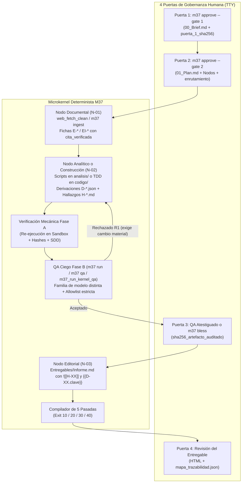

# M37 (Move 37) — Microkernel Epistémico Multiagente para Investigación, Consultoría e Ingeniería Verificable

[](pyproject.toml)
[](.github/workflows/ci.yml)
[](.github/workflows/ci.yml)
[](src/m37/mcp_server.py)
[](LICENSE)

**M37 (*Move 37*)** es un microkernel agéntico determinista en Python (`Pydantic v2` + `LiteLLM` + `MCP`) que opera sobre un **Vault Markdown compatible con Obsidian**.

A diferencia de los frameworks multiagente basados en "buena fe del prompt", **M37 no confía en el LLM para cumplir las reglas**: traslada la gobernanza de puertas humanas, el aislamiento entre clientes (Muralla China), la ingesta autenticada de fuentes, la verificación cuantitativa y la auditoría adversarial a una **capa determinista en código (*fail-closed*)**.

Su núcleo es **100% agnóstico a disciplinas y proveedores de modelos**: ejecuta bajo las mismas garantías encargos de investigación económica, estrategia cualitativa, cumplimiento normativo, modelado cuantitativo reproducible o ingeniería de software dirigida por especificaciones (`SDD + EARS + TDD + AppSec`).

---

## Tabla de Contenidos

1. [Qué garantiza el microkernel (y qué depende del modo de ejecución)](#1-qué-garantiza-el-microkernel-y-qué-depende-del-modo-de-ejecución)
2. [Arquitectura y Flujo de Custodia](#2-arquitectura-y-flujo-de-custodia)
3. [Inicio Rápido (5 Minutos)](#3-inicio-rápido-5-minutos)
4. [Ciclo Operativo y las 4 Puertas Humanas (`TTY`)](#4-ciclo-operativo-y-las-4-puertas-humanas-tty)
5. [Plugin Multi-Harness (`Antigravity`, `Claude Code`, `OpenAI Codex CLI`)](#5-plugin-multi-harness-antigravity-claude-code-openai-codex-cli)
6. [Anatomía del Workspace y Contratos Estrictos](#6-anatomía-del-workspace-y-contratos-estrictos)
7. [Niveles de Rigor (`L1`–`L4`), Fuentes y QA Ciego](#7-niveles-de-rigor-l1l4-fuentes-y-qa-ciego)
8. [Compilador Determinista de 5 Pasadas](#8-compilador-determinista-de-5-pasadas)
9. [Referencia de CLI y Herramientas MCP (`m37-kernel`)](#9-referencia-de-cli-y-herramientas-mcp-m37-kernel)
10. [Sandbox, Seguridad (`AppSec`) y Gobernanza](#10-sandbox-seguridad-appsec-y-gobernanza)

---

## 1. Qué garantiza el microkernel (y qué depende del modo de ejecución)

M37 distingue con transparencia qué invariantes están selladas mecánicamente por el kernel Python y cuáles dependen del modo de ejecución elegido (**Runner autónomo por API** vs. **Modo Harness vía MCP**):

| Invariante / Control | Runner Autónomo (`m37 run`) | Modo Harness (`MCP m37-kernel`) | Mecanismo en código |
| :--- | :---: | :---: | :--- |
| **Contratos `Pydantic v2` (`extra="forbid"`) y linaje `SHA-256`** | Sí | Sí | `schemas.py`, `verify.py` y `compiler.py` recalculan todo desde disco. |
| **Puertas humanas 1 y 2 (`m37 approve`)** | Sí | Sí | `gates.py`: exige terminal interactiva (`TTY`); escribir `puerta_N_aprobada: true` a mano no aprueba la puerta. |
| **Autenticidad de snapshots (`cita_verificada: true`)** | Sí | Sí | Solo cuentan archivos registrados en el manifiesto del kernel por `web_fetch_clean` o por una persona con `m37 ingest`. |
| **Ejecución reproducible de scripts en `Derivaciones/D-*.json`** | Sí | Sí | El kernel ejecuta `productor_ref` (dentro de `analisis/<encargo>/`) y estampa `salidas` y `productor_sha256` desde `stdout`. |
| **QA Ciego atestiguado en `L3`/`L4` (`revision_ciega_verificada: true`)** | Sí (automático) | Con `m37_run_kernel_qa` (API) o `m37 bless` (`TTY`) | El veredicto de un subagente del harness (`m37_record_qa_verdict`) queda como `revision_ciega_verificada: false` (consultivo en `L3`/`L4`). |
| **Aislamiento de herramientas y Muralla China entre clientes** | Total (mediado por `ExecutionGuard`) | Para todo lo que pasa por MCP (usar 1 workspace por cliente) | En backend `process`, el cómputo se bloquea si el workspace contiene encargos de más de un cliente; el backend `container` monta solo el encargo activo sin red. |

---

## 2. Arquitectura y Flujo de Custodia



---

## 3. Inicio Rápido (5 Minutos)

### En Windows (PowerShell)

```powershell
# 1. Crear entorno virtual e instalar M37 (u `uv sync --extra dev --extra full`)
python -m venv .venv
.\.venv\Scripts\pip install -e ".[dev,full]"
Copy-Item .env.example .env

# 2. Diagnóstico del entorno, aislamiento Git y privacidad de API
.\.venv\Scripts\m37 doctor

# 3. Inicializar un workspace operativo fuera del repositorio del motor
.\.venv\Scripts\m37 init ..\m37_workspace

# 4. Auditar en Fase A (re-ejecutando el modelo DCF en sandbox) y compilar el encargo demostrativo DEMO-01
.\.venv\Scripts\m37 verify DEMO-01_entrada-mercado --vault ..\m37_workspace --rerun
.\.venv\Scripts\m37 compile DEMO-01_entrada-mercado --vault ..\m37_workspace --format html
```

### En Linux / macOS (Bash)

```bash
python3 -m venv .venv
source .venv/bin/activate
pip install -e ".[dev,full]"
cp .env.example .env

m37 doctor
m37 init ../m37_workspace
m37 verify DEMO-01_entrada-mercado --vault ../m37_workspace --rerun
m37 compile DEMO-01_entrada-mercado --vault ../m37_workspace --format html
```

> **Dos Anillos (`Bare Bones` vs. `Full`):** Con `pip install -e .` (*Bare Bones*), M37 arranca sin `DuckDB`, `FastMCP` ni `Quarto`: el servidor MCP utiliza su transporte `JSON-RPC 2.0` nativo sobre librería estándar, el grafo bitemporal opera sobre su motor de respaldo en JSON puro y el compilador genera el HTML ejecutivo autocontenido y `mapa_trazabilidad.json`. Además, el wheel empaqueta `starter_vault/` y `extensions/` para que `m37 init` funcione desde cualquier directorio fuera del checkout.

---

## 4. Ciclo Operativo y las 4 Puertas Humanas (`TTY`)

Las aprobaciones de puertas (`m37 approve`), la ingesta manual de fuentes (`m37 ingest`) y las actas de excepción (`m37 bless`) exigen una **terminal interactiva (`TTY`)**: ningún agente ni herramienta MCP puede auto-aprobarlas ni falsificarlas editando el YAML a mano.

```powershell
# 1. Crear un encargo aislado y su contrato 00_Brief.md
m37 new ENC-2026-01 --cliente ACME --rigor L3 --vault ..\m37_workspace

# 2. Revisar 00_Brief.md (incluyendo dominios_web_permitidos en L3/L4) y sellar Puerta 1 en terminal interactiva
m37 approve ENC-2026-01 --gate 1 --vault ..\m37_workspace

# 3. Generar 01_Plan.md y Nodos/N-*.md desde un Arquetipo declarativo (--harness si usarás el agente del IDE)
m37 plan ENC-2026-01 --arquetipo ARQ_Analisis-Cuantitativo --harness --vault ..\m37_workspace

# 4. Revisar el DAG (nodos, dependencias y enrutamiento) y sellar Puerta 2 en terminal interactiva
m37 approve ENC-2026-01 --gate 2 --vault ..\m37_workspace

# 5. (Opcional) Ingestar documentos primarios locales al manifiesto de snapshots verificables
m37 ingest .\reporte_oficial.txt --encargo ENC-2026-01 --vault ..\m37_workspace

# 6. Ejecutar el DAG (con `m37 run ENC-2026-01` por API, o paso a paso desde tu harness vía MCP `m37-kernel`)
m37 run ENC-2026-01 --vault ..\m37_workspace

# 7. Ejecutar QA Ciego del kernel sobre un Hallazgo específico (si operaste los nodos en modo harness)
m37 qa ENC-2026-01 H-ENC-2026-01-01 --vault ..\m37_workspace

# 8. Verificar en Fase A y compilar el entregable en 5 pasadas deterministas (Puerta 4)
m37 verify ENC-2026-01 --rerun --vault ..\m37_workspace
m37 compile ENC-2026-01 --format html --vault ..\m37_workspace

# 9. Cerrar el encargo y promover capital anonimizado (C-YYYYMM-NNN) a 50_Capital/
m37 close ENC-2026-01 --vault ..\m37_workspace
```

---

## 5. Plugin Multi-Harness (`Antigravity`, `Claude Code`, `OpenAI Codex CLI`)

Puedes operar los nodos productivos de M37 directamente con tu suscripción de **Antigravity**, **Claude Code** o **Codex CLI** instalando el plugin y el servidor MCP `m37-kernel`:

```powershell
# Instala en tu usuario (~/.gemini, ~/.claude, ~/.codex) y/o en el proyecto actual sin sobrescribir archivos ajenos
.\.venv\Scripts\m37 plugin install --target all --scope both

# Verifica el estado de instalación en los 3 harnesses
.\.venv\Scripts\m37 plugin status
```

* **Google Antigravity:** Configura `~/.gemini/config/plugins/m37/` (`plugin.json`, `mcp_config.json`, `assets/logo.svg`, `rules/AGENTS.md`, subagente `agents/m37-qa-ciego.md` y `skills/m37/SKILL.md`).
* **Claude Code:** Configura `.claude-plugin/plugin.json`, `.mcp.json`, bloque delimitado en `CLAUDE.md`, subagente `.claude/agents/m37-qa-ciego.md`, skill `.claude/skills/m37/SKILL.md` y comandos `/m37`, `/m37-qa`, `/m37-compile`.
* **OpenAI Codex CLI:** Configura bloque delimitado en `AGENTS.md`, `.agents/skills/m37/SKILL.md` y registra `[mcp_servers.m37_kernel]` en `~/.codex/config.toml`.

> **QA en `L3`/`L4` cuando trabajas en modo harness:** Los nodos productivos (`N-01`, `N-02`, `N-03`) no requieren llaves API externas. Para el QA Ciego atestiguado en `L3`/`L4`, puedes configurar `M37_HARNESS_FAMILY` en `.env` junto con una API key de otra familia y llamar a `m37_run_kernel_qa` (o `m37 qa`), o bien aprobar personalmente el hallazgo en tu terminal con `m37 bless`.

---

## 6. Anatomía del Workspace y Contratos Estrictos

```text
<M37_VAULT>/
├── vault/                              # Vault Markdown compatible con Obsidian
│   ├── 00_Sistema/
│   │   ├── Modelos.yaml                # Catálogo declarativo de modelos, costos y max_output_tokens
│   │   ├── Arquetipos/                 # Plantillas DAG declarativas (ARQ_*.md)
│   │   ├── Agentes/                    # System prompts por rol cognitivo
│   │   └── Skills_Dominio/             # Reglas por dominio
│   ├── 10_Clientes/<CLIENTE>/          # Ficha aislada bajo Muralla China
│   ├── 20_Encargos/<ID_ENCARGO>/       # Perímetro aislado del encargo
│   │   ├── 00_Brief.md                 # BriefContract + sello puerta_1_sha256
│   │   ├── 01_Plan.md                  # PlanContract + modo_ejecucion + sello puerta_2_sha256
│   │   ├── Nodos/N-*.md                # NodeContract (perfil, dependencias, enrutamiento)
│   │   ├── Evidencia_Interna/EI-*.md   # Evidencia confidencial del encargo
│   │   ├── Derivaciones/D-*.json       # Cálculos reproducibles sellados por el kernel
│   │   ├── Hallazgos/H-*.md            # Afirmaciones auditadas con valores_anclados
│   │   ├── QA/V-*.md                   # Veredictos QA (sha256_artefacto_auditado + QA/.r1/*.snapshot)
│   │   └── Entregables/Informe.md      # Borrador con ![[H-*]] e interpolaciones {{D-XX.clave}}
│   ├── 30_Evidencia_Publica/E-*.md     # Evidencia pública reutilizable (append-only)
│   ├── 40_Metodos/*.md                 # Fichas metodológicas canónicas
│   ├── 50_Capital/C-YYYYMM-NNN.md      # Capital anonimizado promovido al cierre
│   └── 90_Bitacora/episodios.jsonl     # Telemetría append-only (solo accesible al orquestador)
├── referencias/
│   ├── _publico/                       # Snapshots descargados por el kernel vía web_fetch_clean
│   └── <ID_ENCARGO>/                   # Snapshots locales registrados vía m37 ingest (bajo Muralla China)
├── analisis/<ID_ENCARGO>/              # Scripts Python reproducibles ejecutados en sandbox
├── codigo/<ID_ENCARGO>/                # Código SDD/TDD + recibo criptográfico .m37_verify_receipt.json
├── datos/<ID_ENCARGO>/                 # Datos crudos (solo lectura) y procesados
└── render/<ID_ENCARGO>/                # Salidas compiladas: HTML, MD, QMD y mapa_trazabilidad.json
```

---

## 7. Niveles de Rigor (`L1`–`L4`), Fuentes y QA Ciego

| Nivel | Propósito | Controles exigidos por el microkernel |
| :---: | :--- | :--- |
| **`L1`** | Exploración rápida | Contratos `Pydantic v2` (`extra="forbid"`), Puertas 1 y 2 selladas y Muralla China. |
| **`L2`** | Investigación y análisis estructurado | Exige hipótesis a falsear en `00_Brief.md` y **Fase A mecánica completa** (integridad de hashes, `productor_ref` dentro de `analisis/<encargo>/` y anclaje cuantitativo) sin requerir QA Ciego. |
| **`L3`** | Consultoría ejecutiva e ingeniería SDD | Todo `L2` + `cita_verificada: true` contra snapshot autenticado (`web_fetch_clean` con `dominios_web_permitidos` o `m37 ingest`) + re-ejecución obligatoria de scripts en Fase A + **veredicto de QA Ciego atestiguado** (`m37 run`, `m37 qa`, `m37_run_kernel_qa` o `m37 bless`) + `M37_DATA_PRIVACY_ACK=paid_billing` en llamadas API. |
| **`L4`** | Operaciones críticas / máxima confidencialidad | Inicialización limpia (`m37 init --clean-l4` sin artefactos demo) + todos los controles `L3`. |

---

## 8. Compilador Determinista de 5 Pasadas

El compilador ([`src/m37/compiler.py`](src/m37/compiler.py)) verifica y ensambla `Entregables/Informe.md` aplicando 5 pasadas:

1. **Pasada 1 (`Exit 10` — Integridad, Puertas, Cuarentena y QA):** Comprueba los sellos `puerta_1_sha256` y `puerta_2_sha256`, verifica Fase A de cada Hallazgo y Derivación, rechaza insumos en cuarentena (`invalidada: true`) y exige veredicto QA atestiguado vigente en `L3`/`L4`. Bloquea celdas ejecutables de Quarto, bloques raw, shortcodes, imágenes remotas, HTML crudo y esquemas de enlace fuera de `http`/`https`/`mailto`.
2. **Pasada 2 (`Exit 20` — Resolución de Transclusiones):** Resuelve `![[H-XX#Afirmación]]` extrayendo la sección del Hallazgo auditado.
3. **Pasada 3 (`Exit 30` — Interpolación Acotada por Bloque y Cifras en Prosa):** Sustituye `{{D-XX.clave | fmt(...)}}` exigiendo que `D-XX` figure en `sustento_derivaciones` de un Hallazgo citado en ese mismo bloque (`<!-- sustento: H-XX -->`), y verifica que toda cifra en la prosa del bloque coincida con los sustentos citados en ese bloque o con `00_Brief.md`.
4. **Pasada 4 (`Exit 40` — Techo Epistémico y Lenguaje Incondicional):** Calcula el techo de fuerza epistémica por bloque (`observacion_acotada` $\rightarrow$ `inferencia_condicionada` $\rightarrow$ `tesis_estructural_o_causal` $\rightarrow$ `prescripcion_accionable`) y aborta ante promesas incondicionales (`riesgo cero`, `100% garantizado`).
5. **Pasada 5 (Exportación y Mapa de Trazabilidad Honesto):** Genera `Informe.html`, `Informe.clean.md`, `.qmd` (`--no-execute`) y `mapa_trazabilidad.json` (con `alcance_verificacion` y `qa_por_hallazgo`, indicando explícitamente: *"Anclajes y linaje verificados mecánicamente · prosa no auditada por QA"*).

---

## 9. Referencia de CLI y Herramientas MCP (`m37-kernel`)

### Comandos CLI (`m37`)

| Comando | Descripción |
| :--- | :--- |
| `m37 init <destino> [--clean-l4] [--force]` | Inicializa un workspace M37 completo a partir de `starter_vault/`. |
| `m37 doctor [--vault <ruta>]` | Audita separación Git, llaves API, privacidad `L3`/`L4`, backend de sandbox y aislamiento de clientes. |
| `m37 new <id_encargo> -c <cliente> -r L3` | Crea la estructura aislada del encargo y su `00_Brief.md`. |
| `m37 approve <id_encargo> --gate 1\|2` | Sella criptográficamente la Puerta 1 (`00_Brief.md`) o Puerta 2 (`01_Plan.md` + nodos) en terminal interactiva (`TTY`). |
| `m37 ingest <archivo> -e <id_encargo>` | Registra un documento primario local en el manifiesto de snapshots verificables (`TTY`). |
| `m37 plan <id_encargo> -a <arquetipo> [--harness]` | Genera `01_Plan.md` y `Nodos/N-*.md` desde un Arquetipo declarativo. |
| `m37 run <id_encargo> [--nodo N-XX]` | Ejecuta los nodos pendientes del DAG por API (`LiteLLM`) con Fase A y QA Ciego Cruzado. |
| `m37 qa <id_encargo> <id_hallazgo>` | Ejecuta QA Ciego atestiguado desde el kernel llamando por API a un modelo de otra familia. |
| `m37 verify <id_encargo> [--rerun]` | Audita en Fase A todas las Derivaciones y Hallazgos del encargo. |
| `m37 compile <id_encargo> [-f html\|md\|pdf\|docx]` | Ejecuta el compilador de 5 pasadas y exporta entregable + `mapa_trazabilidad.json`. |
| `m37 quarantine <id_artefacto> -m "<motivo>"` | Pone en cuarentena persistente una Evidencia o Derivación y propaga la invalidación en cascada. |
| `m37 bless <id_hallazgo> -e <encargo> -j "<razón>"` | Registra aprobación humana firmada (`QA/V-BLESS-*.md`) en terminal interactiva (`TTY`). |
| `m37 close <id_encargo> [-l "<lección>"]` | Cierra el encargo, genera ficha episódica y promueve capital anónimo (`C-YYYYMM-NNN`) a `50_Capital/`. |
| `m37 reindex [--vault <ruta>]` | Proyecta el Vault y `episodios.jsonl` al índice bitemporal (`DuckDB` o JSON fallback, 0 tokens LLM). |
| `m37 plugin install` / `m37 plugin status` | Instala y verifica el plugin multi-harness en Antigravity, Claude Code y OpenAI Codex CLI. |
| `m37 mcp-serve [--vault <ruta>]` | Inicia el servidor MCP `m37-kernel` por `stdio` (`JSON-RPC 2.0`). |

### Herramientas del Servidor MCP (`m37-kernel` — 13 herramientas)

1. `m37_workspace_status` — Estado del workspace, validez de sellos de Puertas 1 y 2, nodos y hallazgos.
2. `m37_init_or_new_engagement` — Inicializa el workspace y/o crea `00_Brief.md`.
3. `m37_plan_engagement` — Compila `01_Plan.md` y `Nodos/N-*.md` desde un arquetipo declarativo.
4. `m37_write_artifact` — Ejecuta acciones bajo `ExecutionGuard` con el perfil del `node_id` activo (`write_note`, `write_script`, `write_code_file`, `run_python_sandbox`, `run_verification_sandbox`, `web_fetch_clean`).
5. `m37_prepare_blind_qa` — Ejecuta Fase A mecánica y devuelve `allowlist_files` + prompt aislado para `m37-qa-ciego`.
6. `m37_record_qa_verdict` — Registra el veredicto del subagente del harness (`revision_ciega_verificada: false`, consultivo en `L3`/`L4`).
7. `m37_run_kernel_qa` — Ejecuta QA Ciego atestiguado desde el kernel por API con un modelo de familia distinta a `M37_HARNESS_FAMILY`.
8. `m37_verify_and_compile` — Ejecuta Fase A completa (con re-ejecución de scripts) y el compilador de 5 pasadas.
9. **5 consultas bitemporales del grafo (0 tokens LLM):** `linaje_artefacto`, `fuentes_por_vencer`, `desempeno_empirico_modelos`, `patrones_rechazo_qa`, `cuellos_presupuesto_arquetipo`.

---

## 10. Sandbox, Seguridad (`AppSec`) y Gobernanza

* **Dos Backends de Sandbox (`M37_SANDBOX_BACKEND`):**
  * `process` (por defecto, *zero-dependency*): ejecuta bajo *audit hooks* PEP 578 (`sys.addaudithook`), bloqueo FFI (`_CtypesBlocker`), entorno limpio sin `*_API_KEY`, reversión transaccional en `finally:` y bloqueo automático si el workspace aloja más de un cliente.
  * `container` ([`extensions/sandbox/Dockerfile`](extensions/sandbox/Dockerfile)): ejecuta en Docker/Podman efímero con `--network=none`, sistema de archivos de solo lectura y montando únicamente las carpetas del encargo activo.
* **Protección Anti-SSRF y Anti-DNS-Rebinding:** `web_fetch_clean` resuelve una sola vez, valida que la IP sea pública y conecta directamente a la IP validada preservando `Host`/SNI, exigiendo además que el dominio figure en `dominios_web_permitidos` del Brief en `L3`/`L4`.
* **Documentación de Auditoría y Licencia:**
  * Historial detallado de cambios y remediaciones: [`CHANGELOG.md`](CHANGELOG.md)
  * Mapa de flujos de red y almacenes en disco: [`docs/DATA_FLOWS.md`](docs/DATA_FLOWS.md)
  * Registro de riesgos estructurales (R1–R9) y controles en código: [`docs/RISK_REGISTER.md`](docs/RISK_REGISTER.md)
  * Distribuido bajo licencia **MIT** ([`LICENSE`](LICENSE)).
