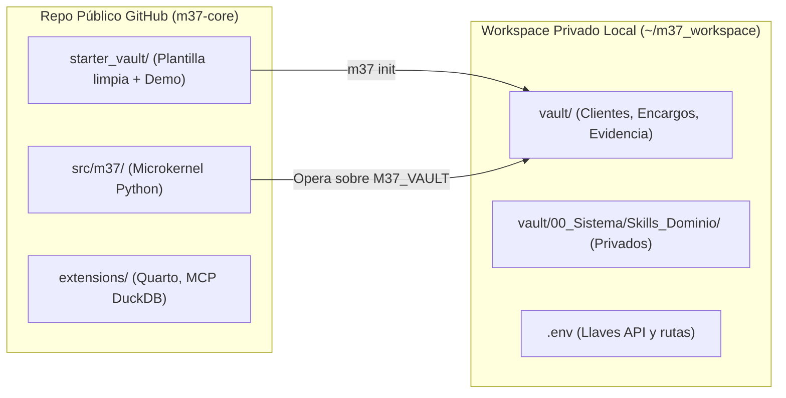

# M37 (Move 37) — SPEC-01: Empaquetado Open-Source, Separación de IP y Modo "Bare Bones"

> **Proyecto:** **M37** (*Move 37*)
> **Especificación:** `SPEC-01` (Etapa 1 de 5)
> **Objetivo:** Definir cómo se estructura, instala, comparte y extiende **M37** para que (1) cualquiera pueda clonarlo y correr un encargo completo en **menos de 5 minutos** sin instalar binarios pesados, y (2) el autor pueda publicar mejoras al motor en GitHub con **riesgo cero** de filtrar datos de clientes o propiedad intelectual privada.

---

## 1. Regla de Oro de Empaquetado: Separación `Motor M37` vs. `Vault de Trabajo`

En versiones conceptuales previas, el motor de agentes y las notas de los clientes compartían la misma raíz Git. Para que **M37** sea un proyecto compartible y open-source, **esa mezcla queda prohibida**.

El sistema se divide en dos directorios físicamente independientes:

1. **Repositorio del Motor (`m37-core/`, público/compartible en GitHub):** Contiene el microkernel en Python (`m37`), los validadores de contratos, el despachador multi-modelo, la plantilla limpia de arranque (`starter_vault/`) y extensiones opcionales. **Jamás almacena clientes reales.**
2. **Workspace / Vault Operativo (`~/m37_workspace/`, privado y fuera del repo del motor):** Instanciado mediante `m37 init ~/m37_workspace`. Tiene su propio repositorio Git local/privado. Aquí viven tus clientes, tus encargos reales y tus *Skills* propietarios de alto valor.



> [!IMPORTANT]
> **Garantía contra fugas en `git push`:** Como `~/m37_workspace/` vive fuera del árbol de `m37-core/` (e incluso si alguien inicializa un vault de prueba dentro de `./workspaces/`, esa ruta está bloqueada en `.gitignore` y rechazada por un chequeo automático en `m37 doctor`), es estructuralmente imposible subir un cliente por accidente al repositorio público.

---

## 2. Árbol Exacto del Repositorio Compartible (`Bare Bones`)

```text
m37-core/
├── pyproject.toml                  # Definición del paquete `m37` y extras opcionales (`uv`)
├── README.md                       # Guía Quickstart de 5 minutos para M37
├── LICENSE                         # MIT o Apache-2.0 (100% código propio, apto para uso comercial)
├── .env.example                    # Plantilla limpia de variables de entorno (M37_*)
├── .gitignore                      # Bloquea .env, workspaces/, *.duckdb, __pycache__/
├── docs/
│   ├── DATA_FLOWS.md               # Mapa exacto de qué sale por red, a qué endpoint y cómo apagarlo
│   └── RISK_REGISTER.md            # Riesgo -> Control en código -> Estado de prueba -> Brecha residual
├── src/
│   └── m37/
│       ├── __init__.py
│       ├── cli.py                  # Interfaz CLI `m37` (`typer` + `rich`)
│       ├── config.py               # Resolución de Vault, .env y estado activo
│       ├── schemas.py              # Contratos Pydantic v2 agnósticos (SPEC-03)
│       ├── router.py               # Selección y validación multi-modelo (SPEC-02)
│       ├── runner.py               # Micro-runner LiteLLM + herramientas envueltas (SPEC-02)
│       ├── guards.py               # Permisos de lectura/escritura, cercas anti-inyección, cuarentena y sandbox (SPEC-03)
│       ├── verify.py               # QA Fase A (integridad, anti-concesión cosmética + plugins de método)
│       └── compiler.py             # Compilador .md / .html nativo + puente opcional a Quarto
├── starter_vault/                  # Copiado al ejecutar `m37 init <ruta>`
│   ├── 00_Sistema/
│   │   ├── Modelos.yaml            # Catálogo declarativo de modelos (editable por usuario)
│   │   ├── Agentes/                # 6 agentes base: orquestador, evidencia, analisis-sintesis, desarrollo-codigo, redaccion, qa-critico
│   │   ├── Skills_Dominio/         # 3 skills agnósticos base (estrategia-base, datos-base, ingenieria-software-base)
│   │   ├── Arquetipos/             # ARQ_Diagnostico-Cualitativo, ARQ_Analisis-Cuantitativo y ARQ_Construccion-Software-SDD
│   │   ├── Contratos/              # Referencia legible de los 6 contratos
│   │   ├── Plantillas/             # Plantillas Markdown para Obsidian
│   │   └── Paneles/                # supervision.base, qa.base, trazabilidad.base, cartera.base
│   ├── 10_Clientes/
│   ├── 20_Encargos/
│   │   └── DEMO-01_entrada-mercado/ # Encargo ficticio pre-cargado para probar el flujo en 2 min
│   ├── 30_Evidencia_Publica/
│   ├── 40_Metodos/                 # Incluye sdd-ears-tdd.md y matriz-comparativa-alternativas.md
│   ├── 50_Capital/
│   └── 90_Bitacora/
├── extensions/                     # Anillo 1 (Modo Full — no requerido en Bare Bones)
│   ├── mcp_episodic_graph/         # Proyección bitemporal DuckDB + servidor fastmcp (SPEC-05)
│   └── quarto_templates/           # Plantillas .docx y .pptx corporativas
└── tests/                          # Suite pytest de aislamiento, enrutamiento y contratos
```

---

## 3. Frontera Exacta: Anillo 0 (`Bare Bones`) vs. Anillo 1 (`Full`)

El modo `Bare Bones` de **M37** **no recorta ningún principio de gobierno** (mantiene contratos estrictos, trazabilidad, aislamiento entre clientes y QA ciego heterogéneo); solo elimina **dependencias de infraestructura pesada**, sustituyéndolas por implementaciones ligeras en Python puro con degradación elegante.

| Capacidad | Anillo 0: `Bare Bones` (`uv sync`) | Anillo 1: `Full` (`uv sync --extra full`) | Comportamiento si falta el extra |
|---|---|---|---|
| **Runtime Python** | Librerías ligeras puras: `litellm`, `pydantic`, `python-frontmatter`, `pyyaml`, `typer`, `rich`, `markdown` | Añade `duckdb`, `fastmcp`, `polars`, `pyarrow`, `trafilatura` | Funciona al 100% con el set base |
| **Binarios externos** | **Ninguno** (ni Docker, ni Node, ni Pandoc; `git` opcional con fallback Python) | `quarto` (incluye Pandoc), Zotero + Better BibTeX | `m37 doctor` informa qué extras están inactivos sin fallar |
| **Interfaz visual** | Cualquier editor de texto u **Obsidian** abriendo `vault/` | Obsidian + paneles `.base` + Zotero conectado | Archivos 100% Markdown estándar |
| **Salida compilada** | `.md` expandido y `.html` limpio autocontenido con CSS de reporte/láminas | `.docx`, `.pptx` y `.pdf` corporativos vía Quarto | Si pides `--format docx` sin Quarto, genera `.html`/`.md` e indica cómo instalar Quarto |
| **Memoria episódica** | `90_Bitacora/episodios.jsonl` + agregador en memoria al planificar (óptimo hasta ~50 encargos) | `vault/.indice/grafo.duckdb` bitemporal + servidor MCP `readonly` | El Orquestador recibe estadísticas resumidas directo desde `episodios.jsonl` |
| **Búsqueda web** | `web_fetch_clean` HTTP estándar + grounding nativo del proveedor si aplica | Conectores especializados opcionales (Tavily / Brave / APIs públicas) | Opera sobre URLs provistas y documentos locales |

### Especificación de `pyproject.toml` (huella mínima)

```toml
[project]
name = "m37"
version = "0.1.0"
description = "Move 37 (M37) — Task-agnostic multi-model agentic kernel"
requires-python = ">=3.11"
dependencies = [
    "litellm>=1.50.0",
    "pydantic>=2.7.0",
    "python-frontmatter>=1.1.0",
    "pyyaml>=6.0.1",
    "typer>=0.12.0",
    "rich>=13.7.0",
    "markdown>=3.6",
]

[project.optional-dependencies]
full = [
    "duckdb>=1.1.0",
    "fastmcp>=0.4.0",
    "polars>=1.5.0",
    "pyarrow>=17.0.0",
    "trafilatura>=1.12.0",
]
dev = [
    "pytest>=8.2.0",
]

[project.scripts]
m37 = "m37.cli:app"
```

---

## 4. Interfaz CLI (`m37`) y Experiencia en 5 Minutos (Mapeada a las 4 Puertas)

### Quickstart de quien clona el repositorio

```powershell
git clone https://github.com/<usuario>/m37-core.git
cd m37-core
uv sync
cp .env.example .env        # Configurar al menos GEMINI_API_KEY (o ANTHROPIC / OPENROUTER)

# 1. Verificar entorno, modelos activos y política de privacidad API
uv run m37 doctor

# 2. Inicializar un workspace limpio fuera del repo
uv run m37 init ../m37_workspace
```

### Ciclo completo de un encargo en 5 comandos

| Paso | Comando CLI | Qué ejecuta M37 | Puerta Humana |
|---|---|---|---|
| **1. Encuadre** | `m37 new ACME entrada-mercado` | Crea carpeta aislada en `20_Encargos/`, genera borrador `00_Brief.md` | **Puerta 1:** Humano revisa el Brief y marca `puerta_1_aprobada: true` |
| **2. Plan y Selección de Modelos** | `m37 plan 2026-10_ACME --orchestrator argon` | El Orquestador elegido lee `00_Brief.md`, `Modelos.yaml` y estadísticas episódicas; instancia el Arquetipo en `01_Plan.md`, **asigna modelo por nodo** y estima costo USD | **Puerta 2:** Humano aprueba método, modelos asignados y presupuesto (`puerta_2_aprobada: true`) |
| **3. Ejecución + QA** | `m37 run 2026-10_ACME` | Ejecuta el DAG nodo por nodo bajo `guards.py`; al producir `Hallazgos/`, corre `verify.py` (Fase A) y lanza sesión aislada `qa-critico` en familia cruzada (Fase B) | **Puerta 3:** Humano revisa `Hallazgos/` y veredictos `QA/` |
| **4. Compilación** | `m37 compile 2026-10_ACME --format html` | Verifica que todo bloque tenga `<!-- sustento: H-XX -->` aprobado y con `hash_insumos` vigente; interpola `{{D-XX.clave}}` y genera entregable | **Puerta 4:** Revisión final antes de entregar al cliente |
| **5. Cierre** | `m37 close 2026-10_ACME` | Comprime telemetría en Tarjeta Episódica (Nivel 1) y lista hallazgos con `promovible_a_capital: true` para anonimizar hacia `50_Capital/` | Post-mortem (10 min) |

---

## 5. Controles de Seguridad, Privacidad y Transparencia Operativa

Plantilla `.env.example`:

```ini
# Ruta absoluta al workspace operativo (DEBE estar fuera del repo m37-core para uso real)
M37_VAULT=C:/Users/tu_usuario/Documents/m37_workspace

# Modelo Orquestador por defecto (alias de Modelos.yaml, sobrescribible con --orchestrator)
M37_ORCHESTRATOR=argon

# Confirmación de términos de privacidad de API:
# - demo_only: permite L1/L2 con llaves gratuitas; BLOQUEA encargos L3/L4 de clientes reales
# - paid_billing: declara que las APIs activas tienen facturación vinculada (sin entrenamiento sobre prompts)
M37_DATA_PRIVACY_ACK=demo_only

# Credenciales de proveedores (activa solo los que tengas; M37 auto-detecta el pool disponible)
GEMINI_API_KEY=
ANTHROPIC_API_KEY=
OPENROUTER_API_KEY=
OPENAI_API_KEY=
```

Controles ejecutados por `m37 doctor`:
1. **Bloqueo de privacidad `L3`/`L4`:** Si `M37_DATA_PRIVACY_ACK != "paid_billing"`, cualquier intento de correr `m37 plan` o `m37 run` sobre un Brief con `nivel_rigor: L3` o `L4` aborta antes de enviar un solo token a la nube.
2. **Protección anti-fuga Git:** Verifica que `Path(M37_VAULT).resolve()` no esté dentro de un árbol Git cuyo `origin` apunte a `m37-core`.

### 5.1 Gobernanza Ligera de Transparencia (`docs/DATA_FLOWS.md` y `docs/RISK_REGISTER.md`)

Para que cualquier cliente corporativo o auditor técnico pueda evaluar `m37-core` en minutos sin burocracia documental (enfoque ligero alineado con el espíritu de transparencia de ISO/IEC 42001):

1. **`docs/DATA_FLOWS.md` (máx. 2 páginas):** Tabla exhaustiva de cada punto de contacto de red y almacén local:
   * *Red:* Llamadas de inferencia `LiteLLM` hacia los endpoints configurados en `Modelos.yaml` y peticiones HTTP explícitas de `web_fetch_clean` en perfil `documental`. Cero telemetría oculta (`litellm.telemetry = False` fijado en `runner.py`).
   * *Almacenes locales:* `vault/` (Markdown/YAML), `90_Bitacora/episodios.jsonl` y `vault/.indice/grafo.duckdb` (solo modo `Full`).
2. **`docs/RISK_REGISTER.md` (máx. 2 páginas):** Vincula cada riesgo estructural (`R1: Contaminación entre clientes`, `R2: Transcripción manual de cifras`, `R3: Prompt injection indirecto en fuentes`, `R4: Concesión cosmética en Ronda 2 de QA`, `R5: Inflación de fuerza epistémica`, `R6: Vibe-coding sin tests verificados o con secretos/vulnerabilidades en código entregable`) con su control exacto en código (`guards.py`, `verify.py`, `compiler.py`), su estado de verificación honesto (`DISEÑADO` / `CUBIERTO_POR_PYTEST` / `CALIBRADO_EN_CAMPO`) y su brecha residual abierta.

---

## 6. Costos y Trade-offs aceptados en `SPEC-01`

* **Costo 1 (Dos carpetas en tu máquina):** `m37-core/` (motor) y `~/m37_workspace/` (operación). Se configura una sola vez en `M37_VAULT`.
* **Costo 2 (Salida HTML/MD nativa en Bare Bones):** La generación directa de `.docx`/`.pptx` queda como extra limpio al instalar Quarto, evitando obligar a nuevos usuarios a descargar ~400 MB de binarios antes de su primera prueba.
* **Costo 3 (Mantenimiento de 2 archivos de transparencia en `docs/`):** ~30 minutos por release menor para mantener sincronizado `RISK_REGISTER.md`, a cambio de confianza inmediata ante clientes con requisitos estrictos de confidencialidad.
