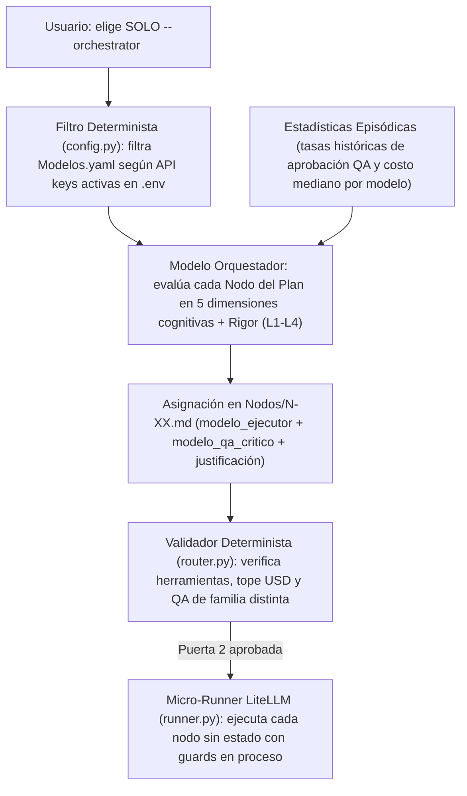
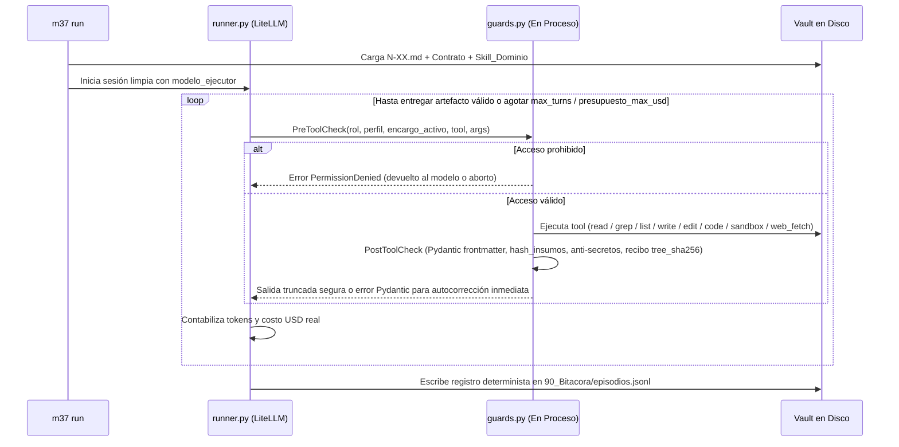

# M37 (Move 37) — SPEC-02: Enrutamiento Agnóstico de Modelos y Runtime Multi-Proveedor

> **Proyecto:** **M37** (*Move 37*)
> **Especificación:** `SPEC-02` (Etapa 2 de 5)
> **Objetivo:** Diseñar el mecanismo donde el usuario **únicamente elige qué modelo actúa como Orquestador**, y ese Orquestador decide con criterio técnico, contextual y económico qué modelo ejecuta cada nodo del plan, manteniéndose **100% inmune al recambio futuro de modelos** y forzando diversidad adversarial en QA.

---

## 1. Arquitectura de Decisión en Dos Capas (Por qué no envejece)

Si los prompts del sistema mencionaran nombres fijos (`"usa Haiku para RAG, Opus para concepto, Argon para documentación"`), **M37** quedaría obsoleto cada trimestre cuando cambian versiones, precios o disponibilidad de llaves API.

En su lugar, **M37** separa **Demanda Cognitiva** (invariante por tarea/nodo) de **Oferta de Modelos** (`00_Sistema/Modelos.yaml`, declarativo y editable sin tocar código ni prompts):



---

## 2. Esquema Declarativo del Catálogo Vivo (`00_Sistema/Modelos.yaml`)

Cualquier usuario edita este único archivo cuando aparece un modelo nuevo o cambia de proveedor (Google AI Studio, Vertex AI, Anthropic, OpenAI, OpenRouter u Ollama local).

```yaml
version_catalogo: "2026-10"
orquestador_por_defecto: "argon"        # Usado si no se pasa --orchestrator ni M37_ORCHESTRATOR

# Escala de capacidades (1 a 5):
# - extraccion_fiel: lectura de alto volumen / RAG sin inventar hechos ni citas
# - abstraccion_conceptual: encuadre estratégico, hipótesis rivales, ambigüedad alta
# - coherencia_documental: redacción extensa, manuales, integración consistente multi-nota
# - ejecucion_formal: código Python, estructuración JSON/YAML estricta, transformaciones
# - critica_adversarial: detección de falacias, sesgos de selección y saltos inferenciales

modelos:
  # --- TIER EXTRACCIÓN RÁPIDA / RAG ---
  gemini-flash:
    litellm_id: "gemini/gemini-3.8-flash"
    familia: "google"
    credencial_env: "GEMINI_API_KEY"
    ventana_max_tokens: 1048576
    costo_usd_1m_in: 0.15
    costo_usd_1m_out: 0.60
    capacidades:
      extraccion_fiel: 4
      abstraccion_conceptual: 2
      coherencia_documental: 3
      ejecucion_formal: 3
      critica_adversarial: 2
    limites_operativos:
      permitir_edit_quirurgico: false   # Solo lectura y escritura de notas nuevas completas
      temperatura_recomendada: 0.1
    notas_orquestador: "Óptimo para triaje masivo de documentos, lectura RAG amplia y notas de evidencia directas a costo mínimo."

  claude-haiku:
    litellm_id: "anthropic/claude-haiku-4-5"
    familia: "anthropic"
    credencial_env: "ANTHROPIC_API_KEY"
    ventana_max_tokens: 200000
    costo_usd_1m_in: 0.80
    costo_usd_1m_out: 4.00
    capacidades:
      extraccion_fiel: 5
      abstraccion_conceptual: 3
      coherencia_documental: 3
      ejecucion_formal: 4
      critica_adversarial: 3
    limites_operativos:
      permitir_edit_quirurgico: false
      temperatura_recomendada: 0.1
    notas_orquestador: "Extracción documental o normativa de alta precisión literal y clasificación rápida de fuentes."

  # --- TIER DOCUMENTACIÓN LARGA / CONTEXTO MASIVO / INTEGRACIÓN ---
  argon:
    litellm_id: "gemini/gemini-4-argon"
    familia: "google"
    credencial_env: "GEMINI_API_KEY"
    ventana_max_tokens: 2000000
    costo_usd_1m_in: 1.25
    costo_usd_1m_out: 5.00
    capacidades:
      extraccion_fiel: 5
      abstraccion_conceptual: 4
      coherencia_documental: 5
      ejecucion_formal: 5
      critica_adversarial: 4
    limites_operativos:
      permitir_edit_quirurgico: true
      temperatura_recomendada: 0.2
    notas_orquestador: "Ideal para redacción técnica/ejecutiva extensa, documentación, código analítico e integración transversal de decenas de notas."

  # --- TIER CONCEPTUAL PROFUNDO / CRÍTICA ADVERSARIAL ---
  claude-opus:
    litellm_id: "anthropic/claude-opus-4-6"
    familia: "anthropic"
    credencial_env: "ANTHROPIC_API_KEY"
    ventana_max_tokens: 200000
    costo_usd_1m_in: 5.00
    costo_usd_1m_out: 25.00
    capacidades:
      extraccion_fiel: 5
      abstraccion_conceptual: 5
      coherencia_documental: 4
      ejecucion_formal: 5
      critica_adversarial: 5
    limites_operativos:
      permitir_edit_quirurgico: true
      temperatura_recomendada: 0.3
    notas_orquestador: "Reservar para nodos de alta ambigüedad conceptual, diseño de contrahipótesis, arbitraje entre dominios y ataque adversarial en QA L3/L4."
```

> [!TIP]
> **Compatibilidad instantánea con OpenRouter, Vertex AI o Modelos Locales:** Para usar una sola llave `OPENROUTER_API_KEY`, Vertex AI (`vertex_ai/...`) u Ollama (`ollama/...`), basta ajustar `litellm_id` y `credencial_env` en `Modelos.yaml`. No se toca una sola línea de Python.

---

## 3. Planificación Híbrida Declarativa y Enrutamiento Multicriterio (`router.py`)

### 3.1 Arquetipos Declarativos (`00_Sistema/Arquetipos/*.md`) + Modo Determinista (0 Tokens) u Orquestador LLM Opcional (`--orchestrator`)
1. **Desacople total de disciplinas (`ArchetypeContract`):** Cada archivo en `00_Sistema/Arquetipos/*.md` declara en su frontmatter YAML la lista topológica de nodos (`nodos`), incluyendo `perfil_herramientas`, `rol_tarea`, `eje_dominante`, `metodo`, `entregables_esperados`, `artefactos_requeridos`, `contexto_estimado_tokens`, `presupuesto_max_usd` y `max_turns`. `cli.py` no contiene condicionales por disciplina; agregar un arquetipo nuevo requiere únicamente crear un archivo Markdown en `00_Sistema/Arquetipos/`.
2. **Modo Determinista por defecto (0 tokens LLM):** Al ejecutar `m37 plan <ID_ENCARGO> --arquetipo <ARQ>`, el microkernel carga y valida el `ArchetypeContract`, filtra `Modelos.yaml` conservando los modelos con credencial activa en `.env`, calcula tasas históricas de rechazo en `episodios.jsonl` y asigna `modelo_ejecutor` y `modelo_qa_critico` por nodo sin gastar tokens de planificación.
3. **Modo Orquestador con LLM opcional (`--orchestrator <alias>`):** Si el usuario pasa `--orchestrator <alias>` (distinto de `determinista`), `resolve_orchestrator_model` valida que `<alias>` exista y esté activo en `Modelos.yaml`, ejecuta una sesión acotada bajo el perfil `orquestador` (`00_Sistema/Agentes/orquestador.md`) con acceso al resumen episódico Nivel 2 y revalida *fail-closed* todos los contratos (`PlanContract`, `NodeContract`, orden topológico acíclico y guardarraíles de ruteo) antes de habilitar la Puerta 2.

### 3.2 Rúbrica Multicriterio por Nodo (`recommend_routing_for_axis`)

Por qué el ruteo evalúa cada nodo y no un mapeo estático `rol -> modelo`: **dos nodos del mismo rol pueden exigir capacidades opuestas**. Extraer 25 fichas de precios públicos es `evidencia` mecánica (`extraccion_fiel` pura → Flash/Haiku); extraer la doctrina implícita en tres sentencias contradictorias también es `evidencia`, pero demanda `abstraccion_conceptual: 5` (Opus/Argon).

Para cada nodo del plan, `router.py` evalúa determinísticamente:
1. **Eje cognitivo dominante** dentro de las 5 dimensiones de `Modelos.yaml`.
2. **Margen de confort de ventana de contexto (60%):** Si `contexto_estimado_tokens` supera el 60% de `ventana_max_tokens` de un candidato, prioriza modelos cuya ventana holgada mantenga el contexto $\le 60\%$.
3. **Política costo-rigor (`L1`–`L4`):**
   * `L1`: minimiza costo por millón de tokens entre modelos capaces ($\ge 3$ en el eje dominante); evita modelos frontera costosos salvo que sean el único disponible.
   * `L2`: usa modelos económicos en ingesta/redacción (`extraccion_fiel`, `coherencia_documental`) y capacidad máxima en síntesis/ejecución formal (`abstraccion_conceptual`, `ejecucion_formal`).
   * `L3`/`L4`: exige capacidad máxima ($\ge 4$) en el eje dominante del ejecutor y puntaje máximo disponible en `critica_adversarial` en una familia distinta para el auditor de QA.
4. **Penalización episódica ($> 35\%$):** `compute_episodic_rejection_rates` inspecciona `90_Bitacora/episodios.jsonl`; si un modelo acumula $> 35\%$ de rechazo en Ronda 1 de QA para ese `dominio` o `metodo`, se penaliza y se selecciona la mejor alternativa activa no penalizada, dejando constancia en `justificacion_ejecutor`.

### 3.3 Los 4 Guardarraíles Deterministas de `router.py`

Antes de habilitar la **Puerta 2** y antes de correr cada nodo en `m37 run`, `router.py` valida sin intervención de LLM:

1. **Existencia en pool activo y cabida en ventana:** Ningún nodo puede referenciar un alias ausente, sin credencial válida o con `ventana_max_tokens < contexto_estimado_tokens`.
2. **Regla de QA Heterogéneo (Diversidad de Proveedor/Familia):**
   * Si hay $\ge 2$ familias activas en `Modelos.yaml` (ej. `google` y `anthropic`), se impone:
     $$\text{familia}(\text{modelo\_qa\_critico}) \neq \text{familia}(\text{modelo\_ejecutor})$$
   * Si solo hay **1 familia activa** (ej. operación inicial usando solo `GEMINI_API_KEY`), se permite la misma familia exigiendo el modelo de mayor `critica_adversarial` activo y mostrando aviso explícito en Puerta 2 (`Modo mono-proveedor`).
3. **Seguridad de herramientas por tier:** Si un nodo requiere `edit_note` o `edit_code_file`, bloquea modelos con `permitir_edit_quirurgico: false`.
4. **Techo presupuestal compartido en USD (4 fases):** `presupuesto_max_usd` es el techo acumulado único del nodo a través de sus **4 posibles fases** (`Ejecución R1` + `QA Ronda 1` + `Re-ejecución R2` + `QA Ronda 2`). Cada fase recibe únicamente el presupuesto remanente (`remaining_budget = presupuesto_max_usd - total_node_cost`), calculando el gasto turno a turno mediante `litellm.completion_cost()` con respaldo automático a las tarifas de `Modelos.yaml`.

---

## 4. El Micro-Runner sobre LiteLLM (`src/m37/runner.py`)

Ejecuta cada nodo como una función pura sobre el sistema de archivos (~195 líneas Python), sin estado compartido en memoria RAM entre nodos.



### Catálogo cerrado de herramientas en proceso (`litellm.telemetry = False` forzado al arranque)

| Herramienta | Perfiles que la reciben | Control en `guards.py` |
|---|---|---|
| `read_file(path, start_line, end_line)` | Todos (QA solo *allowlist*) | Bloquea otros clientes/encargos y artefactos en cuarentena (`invalidada: true`); envuelve lecturas de `30_Evidencia_Publica/`, `Evidencia_Interna/` y `referencias/` en etiquetas `<datos_fuente_no_ejecutables>`; paginación a 25,000 caracteres |
| `grep_vault(query, scope)` | Documental, Analítico, Construcción, Editorial | Restringido a `20_Encargos/<activo>/` (más `codigo/<activo>/` en Construcción) y carpetas públicas (`30_`, `40_`, `50_`), excluyendo archivos con `invalidada: true`; **prohibida en QA ciego** |
| `list_files(folder, pattern)` | Documental, Analítico, Construcción, Editorial | Oculta otros clientes, encargos y artefactos en cuarentena; **prohibida en QA ciego** |
| `write_note(path, content)` | Todos (según matriz de escritura) | Valida esquema Pydantic **antes** de aceptar; respeta carpetas *append-only* |
| `edit_note(path, target, replacement)` | Analítico, Editorial (solo si `permitir_edit_quirurgico: true`) | Prohibida en `30_Evidencia_Publica/` y `Evidencia_Interna/` |
| `write_code_file(rel_path, content)` | Construcción | Confinada exclusivamente a `codigo/<encargo>/` (prohibido tocar `.m37_verify_receipt.json`); escanea y bloquea secretos/valores de `.env` o llaves privadas antes de escribir |
| `edit_code_file(rel_path, target, replacement)` | Construcción (solo si `permitir_edit_quirurgico: true`) | Edición quirúrgica confinada a `codigo/<encargo>/` con escaneo anti-secretos |
| `run_verification_cmd(cmd_kind, args)` | Construcción | Ejecuta comandos verificables en *allowlist* (`pytest`, `unittest`, `ruff`, `mypy`, `npm test`, `cargo test`, `python -m`) en `codigo/<encargo>/` sin API keys de `.env`; sella recibo `.m37_verify_receipt.json` con `exit_code` y `tree_sha256` |
| `run_sandbox_script(script_rel_path, args)` | Analítico (solo si `requiere_computo: true`) | Corre `uv run python` en `analisis/<encargo>/`; revierte cualquier mutación fuera de `analisis/` o `Derivaciones/` |
| `web_fetch_clean(url, save_snapshot)` | Documental | Extrae Markdown limpio envuelto siempre en `<datos_fuente_no_ejecutables origen="web">` y calcula SHA-256 si `save_snapshot=True` |

---

## 5. Telemetría Determinista (`90_Bitacora/episodios.jsonl`)

Escrita exclusivamente por `runner.py` al finalizar cada ejecución:

```json
{"ts": "2026-10-27T21:10:04Z", "evento": "cierre_nodo", "encargo": "DEMO-01", "nodo": "N-02", "rol_tarea": "evidencia", "dominio": "estrategia", "metodo": "Analisis-Canales", "arquetipo": "ARQ_Diagnostico-Cualitativo", "eje_cognitivo": "extraccion_fiel", "modelo": "gemini-flash", "familia": "google", "turnos": 5, "tokens_in": 42100, "tokens_out": 3800, "costo_usd": 0.0086, "estado_salida": "entregado", "errores_contrato_autocorregidos": 1, "modelo_qa": "claude-opus", "familia_qa": "anthropic", "veredicto_qa_r1": "aceptar"}
```

---

## 6. Costos y Trade-offs aceptados en `SPEC-02`

* **Costo 1 (~180 líneas propias de bucle `LiteLLM`):** A cambio de no depender de un CLI cerrado, obtienes control total de herramientas en proceso, costos exactos en USD por nodo y soporte simultáneo para Gemini, Claude, OpenAI, OpenRouter y modelos locales.
* **Costo 2 (Sin auto-compactación opaca de historial):** Si un nodo intenta leer más de lo permitido o entra en bucle, `runner.py` corta limpiamente al llegar a `max_turns` o `presupuesto_max_usd` marcando `estado: bloqueado_presupuesto` (cumpliendo la regla de que la compactación silenciosa degrada calidad sin avisar).
