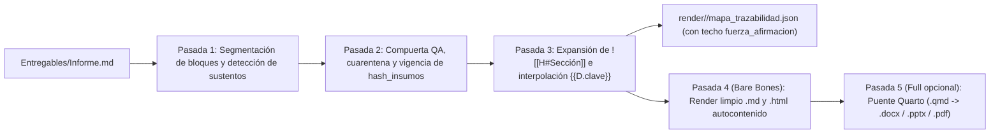

# M37 (Move 37) — SPEC-04: Agentes Nucleares, API de Plugins y Compilador Editorial

> **Proyecto:** **M37** (*Move 37*)
> **Especificación:** `SPEC-04` (Etapa 4 de 5)
> **Objetivo:** Especificar (1) los contratos y prompts agnósticos de los **6 agentes nucleares** incluidos en `Bare Bones`, (2) la **API declarativa de Plugins** para conectar cualquier Dominio, Método o Arquetipo sin tocar `src/m37/` (incluyendo construcción genérica de software SDD/TDD), y (3) el pipeline de 5 pasadas del **compilador editorial** (`src/m37/compiler.py`).

---

## 1. Los 6 Agentes Nucleares de `Bare Bones` (`00_Sistema/Agentes/*.md`)

Todo agente en **M37** se define mediante un archivo Markdown con frontmatter estándar. Los prompts están diseñados bajo formato **estructural-contractual** (agnóstico a si el ejecutor en turno es Claude Opus, Haiku o Gemini Argon).

### Esquema común de definición de agente

```yaml
---
id_agente: analisis-sintesis
tipo: agente
clase: tarea                            # orquestacion | tarea | control
perfil_herramientas: analitico          # documental | analitico | construccion | editorial | qa_ciego
escribe_en:
  - "vault/20_Encargos/{encargo}/Derivaciones/"
  - "vault/20_Encargos/{encargo}/Hallazgos/"
prohibiciones:
  - "Prohibido afirmar hechos sin enlace a Evidencia (E-/EI-) o Derivación (D-)"
  - "Prohibido redactar prosa de entregable final"
---
```

### Catálogo de los 6 Agentes Base

| ID Agente | Clase / Perfil | Mandato exacto (1 oración) | Entradas que recibe | Salidas permitidas |
|---|---|---|---|---|
| **`orquestador`** | `orquestacion` / lectura de índices | Traducir el Brief aprobado en un DAG de nodos instanciado desde un Arquetipo, asignando el modelo óptimo de `Modelos.yaml` a cada paso y arbitrando bloqueos. | `00_Brief.md`, `Arquetipos/*.md`, `Modelos.yaml`, resumen episódico | `01_Plan.md` y `Nodos/N-XX.md` (**jamás escribe evidencia, código, hallazgos ni entregables**) |
| **`evidencia`** | `tarea` / `documental` | Localizar, verificar y registrar fuentes primarias o internas en notas atómicas *append-only* con `localizador_verificable` exacto, separando qué dice la fuente de cualquier interpretación. | Objetivo de `N-XX.md`, `Skill_Dominio`, documentos o URLs (cercados en `<datos_fuente_no_ejecutables>`) | `30_Evidencia_Publica/E-*.md` o `Evidencia_Interna/EI-*.md` + snapshots |
| **`analisis-sintesis`** | `tarea` / `analitico` | Aplicar el `Metodo` asignado y los criterios del `Skill_Dominio` sobre evidencia no invalidada, someter conclusiones a contrahipótesis y emitir derivaciones (incluyendo especificaciones formales EARS/plan técnico) y hallazgos calibrando su `fuerza_afirmacion`. | `N-XX.md`, `Metodo`, `Skill_Dominio`, notas `E-*`/`EI-*` vigentes (y datos locales si `requiere_computo: true`) | `Derivaciones/D-*` (opcional) y `Hallazgos/H-*.md` |
| **`desarrollo-codigo`** | `tarea` / `construccion` | Implementar software modular en `codigo/<encargo>/` obedeciendo estrictamente la Constitución y la Spec EARS aprobadas mediante ciclo TDD *Red-Green-Refactor*, simplicidad *YAGNI*, depuración sistemática de causa raíz y recibo `.m37_verify_receipt.json` en verde antes de emitir entregable. | `N-XX.md`, Spec/Plan en `Derivaciones/D-*`, `Skill_Dominio: ingenieria-software-base` y árbol `codigo/<encargo>/` | Código y tests en `codigo/<encargo>/`, recibo de verificación en `Derivaciones/D-*.json` y `Hallazgos/H-*.md` técnicos |
| **`redaccion`** | `tarea` / `editorial` | Redactar entregables fluidos o manuales técnicos adaptados a la audiencia del Brief apoyándose exclusivamente en hallazgos aprobados, anclando cada bloque con `<!-- sustento: H-XX -->` **sin exceder jamás el techo de `fuerza_afirmacion` de sus sustentos**. | `00_Brief.md`, `N-XX.md`, `Hallazgos/H-*.md` aprobados y llaves de `Derivaciones/D-*` | `Entregables/*.md` listos para `m37 compile` |
| **`qa-critico`** | `control` / `qa_ciego` | Ejecutar un ataque adversarial a ciegas —sin dar por cierto el auto-reporte del ejecutor— verificando (1) fidelidad sustento↔afirmación o cumplimiento exacto Spec EARS↔código/tests + seguridad AppSec, (2) ausencia de inflación en `fuerza_afirmacion` y (3) resolución material en Ronda 2. | **Solo *allowlist*:** artefacto auditado, contrato, rúbrica de dominio, sustentos `E-*`/`D-*` (y archivos `codigo/<encargo>/` + recibo en solo-lectura si aplica; más `V-*-R1.md` si `ronda == 2`) | `QA/V-*.md` con defectos tipados (`DEF-XX`, `exige_cambio_material`) y veredicto |

> **Agentes adicionales en `L3`/`L4` y Modo `Full`:** Usan exactamente el mismo motor y formato de archivo:
> * `validador-dominio.md` (clase `control`, perfil `qa_ciego` extendido al plan en Puerta 2 y a nodos de riesgo alto o `dominios_bloqueantes`).
> * `integrador.md` (clase `control`, perfil `editorial` de solo-verificación: cruza `mapa_trazabilidad.json` entre resumen ejecutivo, cuerpo y láminas para impedir discrepancias y bloquear cualquier inflación de `fuerza_afirmacion` en portada o conclusiones ejecutivas).

---

## 2. API Declarativa de Plugins (Extensibilidad Cero-Código)

Para adaptar **M37** a cualquier práctica o industria, el usuario solo agrega archivos en tres carpetas del Vault:

### 2.1 Plugin Tipo 1: `Skill de Dominio` (`00_Sistema/Skills_Dominio/<dominio>.md`)

Separa deliberadamente las instrucciones de producción de la rúbrica de QA para que `runner.py` inyecte a `qa-critico` únicamente la rúbrica sin ruido extra (`starter_vault/` incluye `estrategia-base.md`, `datos-base.md` e `ingenieria-software-base.md`):

```markdown
---
tipo: skill_dominio
dominio: estrategia
fuentes_prioritarias: ["estados financieros auditados", "entrevistas directas canal", "precios públicos verificables"]
fuentes_sospechosas: ["reportes de mercado genéricos sin metodología declarada"]
---
## Criterios de validez para ejecución
1. Toda ventaja competitiva alegada debe identificar el mecanismo concreto de aislamiento (costos de cambio, economías de escala locales, regulación, red).
2. Prohibido presentar proyecciones de participación de mercado sin modelar la reacción plausible de los incumbentes.

## Errores inaceptables en este dominio
- Confundir tamaño total direccionable (TAM) con demanda capturable en el horizonte del cliente.
- Recomendar guerras de precios sin comparar estructura de costos marginales.

## Rúbrica para QA Crítico
- ¿La recomendación sobrevive si el competidor líder iguala la oferta en 90 días?
- ¿Se descartaron al menos dos explicaciones rivales sobre el comportamiento del cliente?
```

* **`ingenieria-software-base.md` (incluido en `Bare Bones` para tareas de código):**
  * *Criterios de ejecución:* (1) **La Spec manda (SDD):** prohibido implementar comportamiento fuera de los requisitos `RF-*` en notación EARS; cualquier ambigüedad crítica se marca `[NECESITA ACLARACIÓN]`; (2) **Arquitectura limpia y YAGNI:** separar lógica pura de negocio (`core`) respecto a interfaces CLI/API/I-O para testabilidad unitaria directa; (3) **TDD *Red-Green-Refactor* y Depuración Sistemática en 4 fases:** escribir primero el test que falla por el motivo correcto, implementar el código mínimo y, ante cualquier bug, investigar causa raíz e instrumentar fronteras antes de proponer parches; (4) **Línea base AppSec anti-*vibe-coding*:** cero secretos hardcodeados, consultas/comandos parametrizados, validación estricta en fronteras de entrada, verificación explícita de autorización (anti-IDOR) y dependencias reales fijadas (anti-*slopsquatting*).
  * *Rúbrica Dual para `qa-critico`:* **No confiar en el auto-reporte del implementador**; inspeccionar el código/diff real verificando por separado **(A) Cumplimiento exacto de Spec EARS** (ni requisitos omitidos ni código especulativo extra) y **(B) Calidad + Seguridad Aplicativa** (tests que prueban comportamiento real y no solo *mocks*, salida limpia sin *warnings* y ausencia de vulnerabilidades OWASP).

### 2.2 Plugin Tipo 2: `Método` (`40_Metodos/<metodo>.md` + Validador Python Opcional)

```markdown
---
tipo: metodo
id_metodo: matriz-comparativa-alternativas
dominios_afines: ["estrategia", "mercado", "legal", "operaciones"]
requiere_derivacion: true
validador_plugin: null                  # Opcional: nombre de módulo, ej. "sdd_codigo" en sdd-ears-tdd.md
---
## Cuándo usar este método
Evaluación estructurada de N opciones discretas bajo criterios ponderados explícitos y restricciones eliminatorias.

## Procedimiento obligatorio
1. Definir criterios eliminatorios (pasa / no pasa) separados de criterios ponderables.
2. Anclar cada celda de la matriz a una nota de evidencia `[[E-...]]` o `[[EI-...]]`.
3. Realizar prueba de sensibilidad invirtiendo los dos pesos principales.

## Salidas esperadas en Derivación (`D-XX`)
- `alternativa_ganadora`: identificador de opción.
- `robusta_a_sensibilidad`: booleano (`true`/`false`).
```

**Interfaz para validadores Python opcionales (`src/m37/sdd_checks.py` o `extensions/method_validators/<nombre>.py`):**
Si un método declara `validador_plugin: "sdd_codigo"` (como `40_Metodos/sdd-ears-tdd.md`, integrado de fábrica en `Bare Bones`) o un validador financiero/estadístico personalizado, `verify.py` invoca una única función pura:

```python
def validate_method_metadata(derivation: DerivationContract, rigor: str) -> list[str]:
    """Devuelve lista vacía si cumple, o lista de errores deterministas bloqueantes."""
    ...
```

### 2.3 Plugin Tipo 3: `Arquetipo` (`00_Sistema/Arquetipos/<arquetipo>.md`)

Define la topología base del DAG que el Orquestador adapta al Brief. `starter_vault/` incluye **tres arquetipos canónicos** (cualitativo, cuantitativo e ingeniería de software) para cubrir cualquier encargo de consultoría desde el día 1:

1. **`ARQ_Diagnostico-Cualitativo.md` (0 líneas de código):**
   * `N-01` (`evidencia`, perfil `documental`): Levantamiento y verificación de fuentes documentales/internas.
   * `N-02` (`analisis-sintesis`, perfil `analitico`, `requiere_computo: false`): Síntesis estructural, prueba de contrahipótesis y generación de `Hallazgos/H-*.md`.
   * `N-03` (`redaccion`, perfil `editorial`): Redacción de memorando ejecutivo con anclas de sustento.
2. **`ARQ_Analisis-Cuantitativo.md` (cómputo analítico reproducible en `analisis/`):**
   * `N-01` (`evidencia`, perfil `documental`): Registro de diccionarios de datos, parámetros y literatura base.
   * `N-02` (`analisis-sintesis`, perfil `analitico`, `requiere_computo: true`): Limpieza, modelado en `analisis/<encargo>/` y emisión de `Derivaciones/D-01.json`.
   * `N-03` (`analisis-sintesis`, perfil `analitico`, `requiere_computo: false`): Pruebas de robustez/sensibilidad (`D-02.json`) y traducción a `Hallazgos/H-*.md`.
   * `N-04` (`redaccion`, perfil `editorial`): Ensamblado técnico y ejecutivo interpolando `{{D-01.*}}`.
3. **`ARQ_Construccion-Software-SDD.md` (ingeniería de software verificable en `codigo/<encargo>/`):**
   * `N-01` (`evidencia` / `analisis-sintesis`, **0 líneas de código de producción**): Levanta restricciones del cliente/entorno y emite en `Derivaciones/D-01-spec.md` la **Constitución técnica** (stack, límites de dependencias, separación `core` puro vs. I/O) y la **Especificación Funcional en notación EARS** (`RF-01..RF-N` verificables: `CUANDO / SI..ENTONCES / MIENTRAS`, casos límite, fuera de alcance y dudas `[NECESITA ACLARACIÓN]`).
   * `N-02` (`analisis-sintesis`, perfil `analitico`): Traduce el *QUÉ* (`D-01-spec`) al *CÓMO* en `Derivaciones/D-02-plan.md` (módulos, contratos de datos, alternativas descartadas y matriz `RF-XX -> test_*`).
   * `N-03..N-0K` (`desarrollo-codigo`, perfil `construccion`, **un nodo en contexto fresco por módulo/lote independiente**): Ejecuta ciclo TDD *Red-Green-Refactor* en `codigo/<encargo>/`, corre la suite completa vía `run_verification_cmd` sellando `.m37_verify_receipt.json` (`exit_code == 0`, `tree_sha256`), y emite `Derivaciones/D-03-verificacion.json` (`productor_modo: "verificacion_codigo"`, `cobertura_rf`) + `Hallazgos/H-*.md` (`naturaleza: "tecnico"`), auditados a ciegas por `verify.py` (Fase A) y `qa-critico` heterogéneo (Fase B: Spec EARS + Calidad/AppSec).
   * `N-Final` (`redaccion`, perfil `editorial`): Compila el manual de arquitectura/operación y nota de entrega interpolando métricas reales `{{D-03-verificacion.*}}`.

---

## 3. El Compilador Editorial (`src/m37/compiler.py`)

Resuelve la tensión entre **prosa ejecutiva fluida** y **trazabilidad mecánica estricta** mediante un pipeline determinista de 5 pasadas invocado por `m37 compile <encargo> --format <md|html|docx|pptx|pdf>`:



### Reglas exactas de las 5 pasadas

1. **Pasada 1 — Segmentación y Cobertura de Sustento:**
   * Divide el borrador en bloques lógicos (párrafos bajo encabezados `##`/`###` en reportes, o láminas separadas por `---` en presentaciones).
   * Todo bloque sustantivo (excluyendo títulos puros o transiciones declaradas `<!-- transicion -->`) debe contener al menos una etiqueta `<!-- sustento: H-XX, H-YY -->` o ser una transclusión directa `![[H-XX#Afirmación]]`. Bloque huérfano = **Error de Compilación (`Exit Code 2`)**.
2. **Pasada 2 — Auditoría de Compuerta, Cuarentena y Vigencia según Rigor (`L1`–`L4`):**
   * Verifica que ningún `H-*`, `D-*` ni `E-*`/`EI-*` en la cadena de linaje esté en cuarentena (`invalidada: true` o `estado_qa: invalidado`). Si detecta uno, aborta inmediatamente identificando el eslabón contaminado.
   * Recalcula `hash_insumos` de cada `H-*` citado. Si alguno está `desactualizado`, aborta indicando qué insumo cambió aguas arriba.
   * En `L3` y `L4`, verifica que todo `H-*` citado tenga `estado_qa` en `{"aprobado", "aprobado_con_correcciones"}` y que cualquier `dominio_bloqueante` del Brief tenga veredicto aprobatorio registrado.
3. **Pasada 3 — Transclusión, Interpolación sin Discrepancias y Techo Epistémico:**
   * Expande `![[H-ACME-01#Afirmación]]` extrayendo exactamente el sub-árbol Markdown bajo `## Afirmación`.
   * Evalúa expresiones `{{D-ACME-01.metrica}}` o `{{D-ACME-01.metrica | fmt('.1f')}}` leyendo directamente el diccionario `salidas` de `Derivaciones/D-ACME-01.json`. Es estructuralmente imposible que el resumen y el anexo muestren valores distintos.
   * Escribe `render/<encargo>/mapa_trazabilidad.json` mapeando cada sección/lámina final a sus `H-*`, `D-*`, `E-*` subyacentes y al **techo máximo de `fuerza_afirmacion`** autorizado para ese bloque (insumo directo para que `integrador` y la Puerta 4 humana detecten cualquier exageración editorial).
4. **Pasada 4 — Render Nativo `Bare Bones` (`.md` + `.html`):**
   * Elimina comentarios `<!-- sustento: ... -->`, convierte wikilinks internos `[[E-202610-001]]` en notas al pie / bibliografía numerada limpia (incluyendo su `localizador_verificable`) al final del documento y produce:
     * `Informe_limpio.md` (Markdown estándar portable sin sintaxis propietaria de Obsidian).
     * `Informe.html` (HTML5 autocontenido con hoja CSS editorial limpia para lectura o impresión directa a PDF desde cualquier navegador, sin requerir Pandoc ni LaTeX).
5. **Pasada 5 — Puente Corporativo `Quarto` (Modo `Full`):**
   * Si el usuario solicita `docx`, `pptx` o `pdf`, verifica `shutil.which("quarto")`. Si existe, envuelve el Markdown limpio en un `.qmd` inyectando las plantillas de `extensions/quarto_templates/` (y `biblioteca.bib` si Zotero está configurado) e invoca `quarto render`. Si Quarto no está instalado, entrega el `.html`/`.md` de Pasada 4 con instrucciones de instalación en 1 línea.

---

## 4. Costos y Trade-offs aceptados en `SPEC-04`

* **Costo 1 (Disciplina de etiquetas `<!-- sustento: H-XX -->` y techo `fuerza_afirmacion` para `redaccion`):** El redactor no puede escribir párrafos "libres" con afirmaciones nuevas ni inflar una observación condicionada a tesis causal. *Por qué es deseable:* si el redactor descubre un hueco argumentativo, falla la compilación o solicita un hallazgo adicional, eliminando tanto la alucinación como la sobreventa editorial.
* **Costo 2 (Formateador restringido en `{{D.clave | fmt(...)}}`):** No usamos Jinja2 libre para evitar ejecución de código en plantillas; solo un parser regex de ~25 líneas que soporta especificadores estándar de formato Python (`fmt('.1f')`, `fmt(',d')`).
